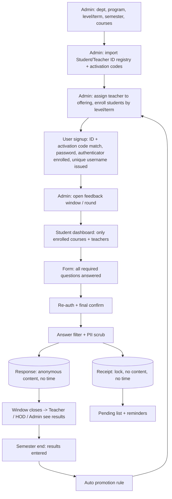
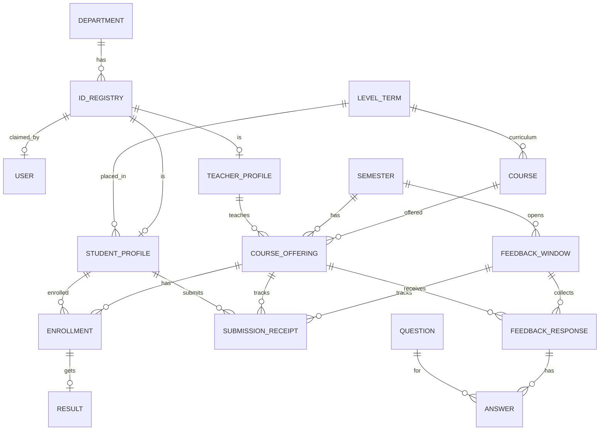

# TFS Blueprint (v2 — reviewed)
Roles of the author: Senior Software Architect + UX Designer + Prompt Engineer. Prompts read only the § they name.
Visual source of truth: `design/*.html` (open in a browser). Tokens in §6 are WCAG-AA validated.

## §1 Key decisions
| Concern | Decision | Why |
|---|---|---|
| Language/Framework | Python 3.12 + **Django 5.2 LTS**, server-rendered | One language, batteries included, long-term support |
| Frontend | **Tailwind v4** (via `django-tailwind-cli`, no Node) + **Alpine.js CSP build** + HTMX + Chart.js, all vendored (no CDN) | Rich UI, strict CSP (no `unsafe-eval`), works offline |
| DB | PostgreSQL (SQLite allowed for quick local runs only) | Row locks + constraints for the one-time rule. SQLite ignores `select_for_update` |
| Jobs | Celery + Redis | Reminders, window notices. Window open/closed is **computed from datetimes at request time**, never trusted to a job |
| Passwords | Argon2id | Strongest default |
| Field encryption | Fernet (MultiFernet for rotation) + separate HMAC key for blind-index lookups | Student/teacher ID, contacts, names, free text, drafts |
| 2FA | TOTP (`pyotp`) authenticator app mandatory for **every role**; 8 hashed single-use recovery codes; no e-mail/SMS codes | Works offline, no SMS/e-mail cost, no contact data needed for auth |
| Abuse control | django-axes + django-ratelimit (Redis cache) | Lockout + throttling |
| Answer filter | 3 layers: word-list/regex (EN+BN+Banglish) → junk heuristics → optional AI classifier (pluggable, OFF by default) + PII scrubber | Local-first protects privacy |
| Exports | openpyxl, WeasyPrint (server-rendered SVG/CSS charts, no JS), csv (UTF-8 BOM, formula-injection safe) | Excel/PDF/CSV |
| i18n / locale | Django i18n `bn` (default) + `en`; `TIME_ZONE=Asia/Dhaka`, `USE_TZ=True` | Bangladesh university |
| Roles | `STUDENT`, `TEACHER`, `ADMIN`; **HOD = TEACHER + `is_hod` + department** (a HOD is also a teacher) | As requested: HOD is a role inside teachers |
| Filter action | **Remove** abusive words (`PROFANITY_ACTION=remove\|mask`) | Owner said delete |
| Dev platform | Owner is on **Windows** (`D:\Git\Teachers_Feedback_System`): Docker Desktop recommended, PowerShell scripts alongside Makefile, LF line endings enforced | Avoids CRLF/Make/WeasyPrint/Celery pitfalls |

## §2 Workflow


## §3 Feature tree
```
TFS
├── F1 Identity & Access
│   ├── Roles Student/Teacher/Admin + HOD flag (department-scoped)
│   ├── ID registry: admin pre-registers Student IDs + Teacher IDs (+ dept/level/term) and one-time activation codes
│   ├── Signup only if ID matches + unclaimed + activation code valid; set password; enrol authenticator (QR) and verify the first code; 8 recovery codes shown once
│   ├── Unique non-guessable username per ID (immutable); editable nickname only; forgotten username: ask the department/Admin (shown on the account page)
│   ├── Student ID (and optional full name) visible to Admin + HOD of the student's own department only
│   ├── Login: Argon2 password then TOTP (or recovery code) for every role, lockout, rate limit, single session, idle timeout
│   └── Password reset with username + TOTP/recovery code; lost phone: Admin "Reset access" (new activation code, re-enrol); strong password policy, session list, "log out everywhere"
├── F2 Academic Management (Admin does everything)
│   ├── Department, Program, Level/Term, Semester (one current), Course (theory/lab, belongs to a level/term)
│   ├── CourseOffering = course + semester + teacher + section
│   ├── Assign teacher to offering; enroll students by level/term; retakes; electives individually
│   ├── CSV import with preview + row-error report (UTF-8/UTF-8-BOM, size limit)
│   └── Results -> term GPA/CGPA -> auto promotion (promote / retain / promote-with-retakes / graduate), admin override with reason
├── F3 Student
│   ├── Profile dashboard (see §4)
│   ├── Courses auto-loaded from level/term + enrollment
│   ├── Hybrid feedback form: ratings + choice + text; every required question must be answered
│   ├── Draft save, re-auth, final confirm
│   └── Once per (course, round); no proxy; no other dept/teacher
├── F4 Feedback engine
│   ├── Question bank (admin editable, EN+BN, versioned once answered)
│   ├── Feedback windows = rounds per semester (auto open/close), optional dept / level-term scope
│   ├── Answer filter (remove abusive/empty/gibberish + scrub phone/email/ID-like text)
│   └── Anonymity (receipt/response split, no timestamps, UUID keys, min-response threshold, results after close)
├── F5 Teacher panel: own courses, question-wise answers together in serial, average rating, distribution, comments, trends, PDF
├── F6 HOD panel: dept overview, teacher ranking, pending list (with Student ID), alerts, drill-down
├── F7 Admin panel: users, academics, windows, question bank, filter words, moderation, analytics, audit log, settings
├── F8 Notifications: in-app, email, SMS-ready reminders, templates, quiet hours
├── F9 Reports: PDF/Excel/CSV, role-scoped, audited
└── F10 Quality: security, bilingual, responsive, accessible, tests, Docker, CI, docs
```
**Extras included (remove any you don't want):** min-response threshold, results released after window closes, stable-shuffled comments, no timestamps on feedback rows, draft save, re-auth before submit, new-device notice, multiple rounds, teacher "action taken" note, comment flag/moderation queue, TOTP for Admin/HOD, activation codes (anti-squatting), PII scrubber, question versioning, retention + backup + key-rotation commands, maintenance mode, demo seed.

## §4 Screens (wireframes — pixel reference is `design/`)
**Student dashboard (profile = hero)** → `design/student_dashboard.html`
```
┌ Navbar: logo · [বাংলা|EN] · 🔔 · 🌙 · avatar ┐
│ ┌ Profile card ─────────────────────────────┐ │
│ │ (avatar) Nickname        ◔ 3/6 done       │ │
│ │ Dept · Batch · Level-2 Term-1 · Spring 26 │ │
│ │ Round closes in 2d 5h    ▓▓▓▓▓░░░         │ │
│ └───────────────────────────────────────────┘ │
│ Courses this semester                           │
│ ┌ CSE 2205 Database  (photo) Dr. X ─ [Pending] ┐│
│ ┌ CSE 2207 Algorithms (photo) Ms. Y ─ [Done ✓] ┐│
└ Privacy note: "Your feedback is anonymous" ────┘
```
(Student ID NOT shown; setting `SHOW_OWN_ID_TO_STUDENT` default off. Username is shown on own profile; it is a login name, not the ID.)

**Feedback form** → `design/feedback_form.html`: sticky progress bar · category sections · star rating (keyboard+touch, numeric value always shown) · unanswered highlighted · Save draft · Submit → re-auth + modal "Final and anonymous".

**Teacher course report** → `design/teacher_report.html`: header (course, semester, round, response rate) → per question in serial: rating = avg + star bars + count; choice = % bars; text = cleaned comments (stable-shuffled, sentiment tag, search) → radar by category → trend line → strengths/improve → dept average → action-taken note → PDF.

**HOD / Admin** → `design/admin_dashboard.html` (HOD uses the same layout, department-scoped): stat tiles → teacher ranking → category heatmap → pending list (Student ID visible) → quick actions → recent audit → moderation queue.

Pages: landing, login, signup stepper (ID+code → password → authenticator → recovery codes), forgot password/username, dashboards per role, management screens, audit log, settings, 403/404/500.

## §5 Data, anonymity, permissions
### §5.1 Entities

Why `STUDENT_PROFILE`/`TEACHER_PROFILE` exist: the admin enrolls students and assigns teachers **before** they sign up, so enrollment and offerings point to profiles (created at import time), never to `User`. `User` links to its registry row at signup. Promotion edits `StudentProfile.level_term` (single source of truth).

### §5.2 Anonymity rules (all tested in P20)
- A1 `FeedbackResponse` and `Answer`: UUID primary keys, **no relation path** to `User`, `StudentProfile`, `Enrollment` or `SubmissionReceipt`, **no timestamps** (only `offering` + `window`), no IP, no session id.
- A2 `SubmissionReceipt(student_profile, offering, window)` is unique and holds no content and no time. It exists only for the lock, the pending list and reminders.
- A3 Teacher/HOD results are released **after the round closes** (setting `RESULTS_VISIBLE=after_close`, default). No live counters that allow "a new row appeared when X submitted".
- A4 Any aggregate **and any comment list** with fewer than `MIN_RESPONSES` (default 5) responses shows "not enough responses". Filtered slices are checked too.
- A5 Comments are shown in a **stable shuffle** (seeded by offering+window+secret so pagination works, unrelated to insertion order).
- A6 Drafts are encrypted, owner-only, deleted on submit and by retention.
- A7 Logs/audit/exports never contain feedback text; exports have no per-response rows with ids or times.
- A8 Form warns "do not write your name or personal details"; filter scrubs phone numbers, e-mails and ID-like numbers from comments.

### §5.3 Permissions
| Resource | Student | Teacher | HOD (teacher + dept) | Admin |
|---|:-:|:-:|:-:|:-:|
| See Student ID / full name | ❌ | ❌ | students of own dept | ✅ |
| Submit feedback | ✅ enrolled, window open, once per round | ❌ | ❌ | ❌ |
| Own course reports | ❌ | ✅ (after close) | ✅ (as teacher) | ✅ |
| Other teacher report | ❌ | ❌ | offerings of own dept | ✅ |
| Who has NOT submitted | ❌ | count only | ✅ own-dept students with ID | ✅ |
| Who wrote what | ❌ | ❌ | ❌ | ❌ |
| Academic / enrollment / results / questions / windows | ❌ | ❌ | ❌ | ✅ |
| Audit log | ❌ | ❌ | own dept | ✅ |
| Export | ❌ | own | own dept | ✅ |

Edge rules: an offering's **department = `course.department`**; HOD scope follows that. A student from another department enrolled in a service course is *counted* in the HOD's pending numbers but listed with Student ID only to their own HOD and the Admin. One HOD per department at a time (history kept). Admin account is created by `manage.py create_admin` (no public signup path).

### §5.4 Threat model (checked in P20)
| Threat | Mitigation |
|---|---|
| Account squatting (someone claims another student's ID) | Single-use hashed activation code + authenticator enrolment; admin can revoke a claim |
| Proxy submitting | Re-auth at submit, single session, new-device notice, rate limit, audit |
| De-anonymising via time/order/ids | A1–A5, no timestamps, UUIDs, stable shuffle, results after close |
| User/ID enumeration | Generic messages, constant-time work, throttling |
| IDOR / privilege escalation | Deny-by-default, object-level checks, role×URL matrix test |
| XSS via comments | Auto-escape, strict CSP with nonces, no inline JS, Alpine CSP build |
| CSV/Excel formula injection | Prefix `'` on cells starting `= + - @` in exports; sanitise on import |
| Malicious upload (avatar) | Type sniff, size cap, Pillow re-encode, strip EXIF, random file name |
| Secret/PII in logs | Log scrubber filter; never log TOTP codes/secrets, recovery or activation codes, passwords, feedback |
| Audit tampering | Append-only model, DB-level revoke of UPDATE/DELETE where possible, hash-chained rows |
| Brute force | axes lockout + ratelimit + Argon2 |
| Key loss/leak | Key rotation command, keys only in env, documented backup |

**Promotion rule** (admin-configurable): max failed courses, min CGPA, min credits. Outcomes: promote / retain / promote-with-retakes / graduate (last term). Preview -> apply (atomic, idempotent) -> admin override with reason (audited).

## §6 Design tokens (WCAG-AA validated; the original amber/emerald values failed AA as text)
Defined as CSS variables, switched by `.dark`, exposed to Tailwind v4 through `@theme inline` in `static/src/tokens.css`.

| Token | Light | Dark | Use / contrast |
|---|---|---|---|
| `bg` | `#F8FAFC` | `#0F172A` | page |
| `surface` | `#FFFFFF` | `#1E293B` | cards |
| `text` | `#0F172A` | `#E2E8F0` | 17:1 / 14:1 |
| `muted` | `#475569` | `#94A3B8` | secondary text 7:1 / 6:1 |
| `subtle` | `#64748B` | `#94A3B8` | hints, **only on bg/surface** (4.6:1) |
| `border` | `#E2E8F0` | `#334155` | decorative card edges |
| `border-input` | `#64748B` | `#7C8DA5` | form controls (≥3:1 non-text) |
| `primary` | `#1E3A8A` | `#93B4FF` | buttons/links (white-on-primary 10:1; dark: text `#0F172A` 8.7:1) |
| `primary-600` (hover) | `#2548B0` | `#7BA3FF` | |
| `primary-soft` | `#EFF4FF` | `#1E2A4A` | tinted areas |
| `success` | `#047857` | `#34D399` | text 5.5:1; bright `#10B981` decorative only |
| `warning` | `#B45309` | `#FBBF24` | text 5:1; bright `#F59E0B` decorative only |
| `danger` | `#DC2626` | `#F87171` | text 4.8:1 / 5.3:1; soft bg text `#B91C1C` |
| `star` | `#D97706` | `#FBBF24` | ≥3:1; **always show numeric value too**; empty star stroke `#64748B` |
| `focus` | `#2548B0` | `#93B4FF` | 3px ring, 2px offset |

Fonts: Plus Jakarta Sans (EN), Hind Siliguri (BN) — **self-hosted woff2** (files + OFL license already in `design/fonts/`, copy to `static/fonts/`), `font-display: swap`; PDF uses embedded Noto Sans Bengali / Hind Siliguri TTF. Scale 12/14/16/20/24/32. Radius: cards 16, buttons 12, chips 999. Spacing 4/8/12/16/24/32. Shadow soft `0 4px 20px rgba(15,23,42,.06)`. Touch target ≥ 44px. Never use colour alone (add icon/text).

## §7 Working tree
```
Teachers_Feedback_System/
├── CLAUDE.md  manage.py  pyproject.toml  Makefile  scripts/dev.ps1  Dockerfile  docker-compose.prod.yml
├── .env.example  .gitignore  .gitattributes  .editorconfig  .pre-commit-config.yaml  .github/workflows/ci.yml
├── requirements/{base,dev,prod}.txt
├── config/{settings/{base,dev,prod}.py, urls.py, celery.py}
├── apps/
│   ├── core/{encryption.py, permissions.py, middleware.py, logging.py, templatetags/}
│   ├── accounts/{models.py, services/{signup,twofactor,recovery,username,student_id_policy}.py, views/, forms.py}
│   ├── academics/{models.py, services/{importers,promotion}.py, views/}
│   ├── enrollment/
│   ├── feedback/{models.py, services/{submit,filter,anonymity}.py, views/, management/commands/load_questions.py}
│   ├── analytics/{services.py}
│   ├── reports/  notifications/  auditlog/
├── templates/{base.html, components/, accounts/, student/, teacher/, hod/, admin_panel/, errors/}
├── static/{src/tokens.css, vendor/, fonts/}  locale/bn/  data/filter/{en,bn,banglish}.txt
├── design/{index.html, tokens.css, mockup.css, mock.js, fonts/, student_dashboard.html, feedback_form.html, teacher_report.html, admin_dashboard.html}
├── docs/{BLUEPRINT.md, QUESTION_BANK.md, SECURITY.md, PERMISSIONS.md, DEPLOYMENT.md, ADMIN_GUIDE.md, USER_GUIDE.md}
└── tests/{security,anonymity,integration}/
```

## §8 Requirement coverage
| Your requirement | Prompt |
|---|---|
| 3 account types + HOD role | P04 |
| ID match at signup, unique username, ID visible to Admin/HOD only | P04, P05 |
| Level/term -> courses + teachers, beautiful student profile | P12 (+ `design/`) |
| Questions + ratings, cannot submit unless all answered | P10, P12, P09 |
| Teacher sees answers per question in serial + avg rating | P14 |
| AI filter for bad/empty words | P11 |
| High security, hashing, encryption | P03, P05, P20 |
| One-time, no other dept/teacher, no proxy | P09, P12 |
| Admin/HOD view plan | P15, P16 |
| Admin adds students by level/term, auto promotion, assigns teachers | P06, P07, P08 |
| Question/rating topics later | P10 + `QUESTION_BANK.md` |
| Feedback "every few days" in a semester | Rounds in P10 (unique per student+course+round) |
| Earlier GitHub issues #1–#24 (+#19 HOD dashboard) | all, nothing missed |

## §9 Assumptions — confirm or change before building
1. "kali/gali" = abusive/vulgar words. 2. "Once" means **once per course per round**; if you want once per semester, create only one round. 3. One teacher per offering; theory+lab or co-taught = separate offerings. 4. HOD is a teacher with `is_hod`; sees offerings whose **course department** is theirs. 5. Teachers/HOD see results only after the round closes. 6. `MIN_RESPONSES=5`. 7. Students need an activation code (printed/sent by admin) plus an authenticator app. 8. Every role must use TOTP 2FA. 9. Default language Bangla, timezone Asia/Dhaka. 10. Full name is optional and follows the Student-ID visibility rule. 11. Editing an already-answered question creates a new version.
